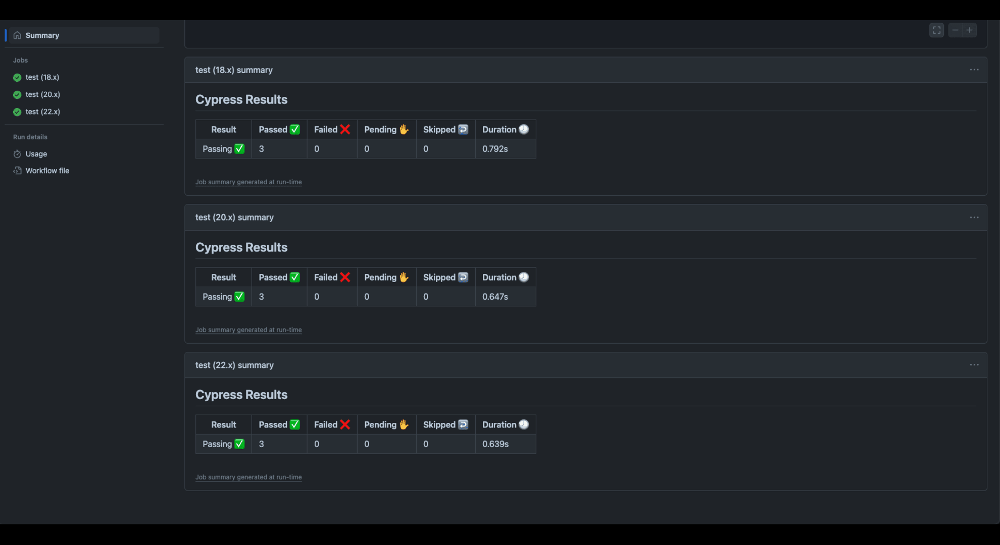

# CI/CD Pipeline with GitHub Actions and Render

A MERN tech quiz used to practise a real delivery pipeline: Cypress component tests run on every pull request, and a merge to `main` builds the app and deploys it to Render.

**Live app:** https://two0-ci-cd-github-actions-zubp.onrender.com

> Hosted on Render's free tier, so the first visit after a quiet spell can take a while to wake up.



*Cypress results from an earlier version of the workflow, which ran a Node 18, 20 and 22 matrix. The current workflow runs on Node 22 only.*

## What it does

- **CI** (`.github/workflows/tests.yml`): on pull requests to `develop` or `main`, installs with `npm ci`, builds the app and runs the Cypress component tests.
- **CD** (`.github/workflows/deploy.yml`): runs only when a pull request into `main` is closed and merged. It installs, verifies the production build, then calls the Render deploy hook once.
- **The app:** a React and TypeScript quiz served by an Express API, with questions stored in MongoDB.
- **Branching:** `feature/*` to `develop` to `main`.

## Tech stack

| Area | Tools |
|---|---|
| Front end | React 18, TypeScript, Vite |
| Back end | Node.js, Express 4, Mongoose, MongoDB |
| Testing | Cypress 13 (component tests) |
| CI/CD | GitHub Actions, Render |

## Run it locally

Needs Node.js and a MongoDB database. Copy `server/.env.EXAMPLE` to `server/.env` and set:

- `MONGODB_URI`
- `PORT` (optional, defaults to 3001)

```bash
npm install     # installs root, server and client dependencies
npm run build   # builds the server and the client
npm run seed    # loads the questions into MongoDB
npm start       # serves the app on http://localhost:3001
```

For development with live reload, use `npm run develop`.

## Test it

```bash
npm run test-component   # Cypress component tests, headless (what CI runs)
npm run test-gui         # open the Cypress UI
```

## Pipeline setup

The deploy workflow needs one repository secret, `RENDER_DEPLOY_HOOK`, holding the Render deploy hook URL. It is never stored in the repo.

## What I learned / built

- Splitting CI and CD into separate workflows, and making deploys fire only on a merged pull request rather than any closed one.
- Keeping a deploy hook in a GitHub secret and failing the job loudly (`curl --fail`) if the hook call breaks.
- Running component tests with Cypress against a mocked API so the pipeline needs no database.
